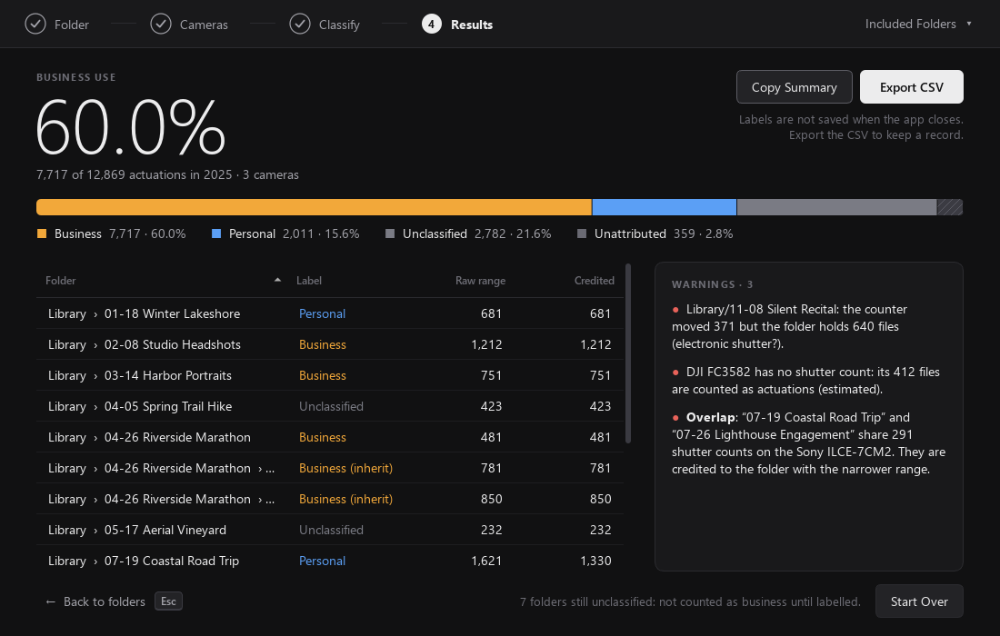
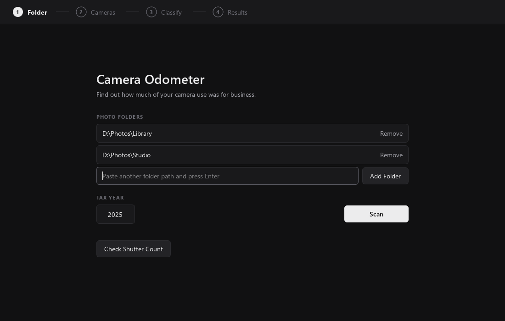
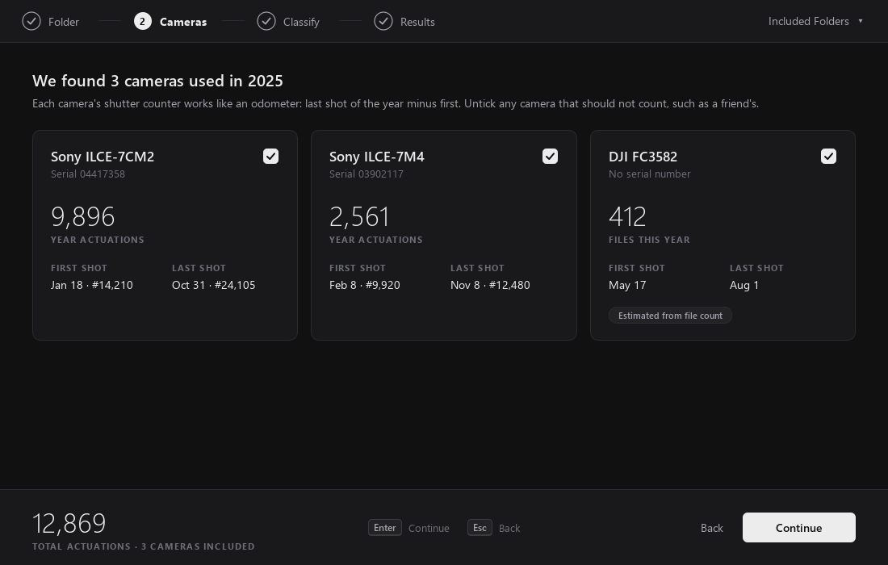
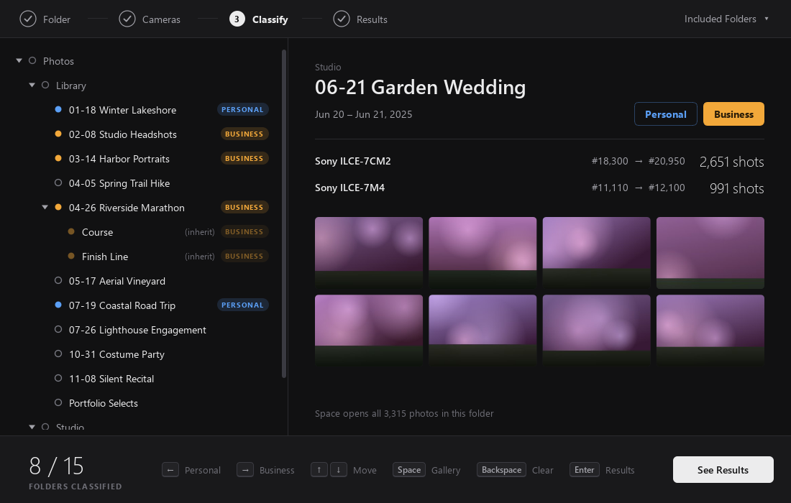
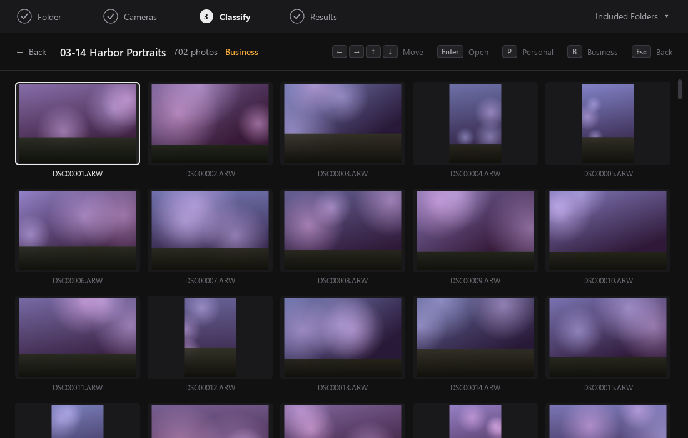

# Camera Odometer Calculator

Windows desktop app that works out what share of your camera use in a tax year was for business, from the shutter counts in your photos.



## Why

If your camera gear does paid work and personal shooting, your tax records may need its **business-use percentage**. A car has an odometer for this. Cameras have one too: most bodies write their **shutter count** into every photo. This app reads that count, splits the year's shots between your business and personal folders, and gives you the percentage with a CSV to back it up.

## Features

- **Yearly odometer per body**: finds each camera's first and last shot of the year from one or several photo libraries.
- **Fast folder labelling**: flip through folders and mark each **Personal** (`←`) or **Business** (`→`). Peek at the photos with `Space`.
- **Honest totals**: every shutter actuation of the year lands in exactly one bucket. Deleted or missing shots count as *not* business.
- **Warnings** for overlapping folders, silent-shutter gaps and cameras without a shutter count.
- **CSV export** of the folder-by-folder breakdown, to keep with your tax papers.
- **Check Shutter Count** for one image, handy when buying or selling a used camera, plus a full metadata viewer.
- **Read-only and offline**: it never changes your photos and sends nothing anywhere.

## How it works

| 1. Pick folders and a year | 2. Check the cameras |
| --- | --- |
|  |  |
| **3. Label each folder** | **4. Look inside a folder** |
|  |  |

- A scan reads a few files per folder, not every photo: about a minute for 25,000 files the first time, seconds after that.
- When two folders cover the same stretch of a counter, the narrower one wins. The exact rules: [calculation](docs/calculation.md).

## Download

1. Get `CameraOdometer.exe` from the [latest release](https://github.com/PoyoPoak/camera-odometer-calculator/releases/latest). One file, Windows 10 / 11, 64-bit, no installer.
2. Put it in a folder of its own that you can write to (not `Program Files`) and start it. It keeps a little state in a hidden `.data` folder next to itself.
3. The first start takes 10 to 20 seconds while Windows scans the new file.

- The exe is **not code-signed**, so Smart App Control or SmartScreen may block it. See [troubleshooting](docs/development.md#troubleshooting).
- How to use it: [user guide](docs/user-guide.md).

## Limits

- **Windows only** for the app. The engine and its scan CLI also run on Linux.
- **Not every camera records a shutter count.** Many phones and drones do not: their files count as one actuation each and are flagged *estimated*.
- **Labels are not saved** when the app closes. Export the CSV at the end of a session.
- **Not tax advice.** The app measures camera use. Whether and how you can deduct it depends on where you live: ask a tax professional.

## Build from source

Needs Windows Python 3.12. From WSL (or any shell, with the paths adapted):

```bash
python.exe -m venv .venv-win
chmod +x .venv-win/Scripts/*.exe        # WSL only
.venv-win/Scripts/python.exe -m pip install -r requirements.txt
.venv-win/Scripts/python.exe scripts/build.py
```

- The build downloads the pinned ExifTool once and checks its hash.
- The result is `dist/CameraOdometer.exe`.
- Run from source, tests and troubleshooting: [development guide](docs/development.md).

## Documentation

| Page | Contents |
| --- | --- |
| [User guide](docs/user-guide.md) | Steps, keyboard, terms, accuracy notes |
| [Calculation](docs/calculation.md) | How the business percentage is computed |
| [Design](docs/design.md) | UI / UX: flow, screens, keyboard map |
| [Architecture](docs/architecture.md) | Modules, engine API, smart scan, data folder |
| [Development](docs/development.md) | Setup, tests, building the exe |

## Contributing

Issues and pull requests are welcome. Before a pull request, run the checks that fit your change, listed in [`.claude/skills/validate/SKILL.md`](.claude/skills/validate/SKILL.md): at least `python3 -m unittest discover -s tests`, and `main.py --selftest` for UI changes.

## Credits

- Metadata is read with [ExifTool](https://exiftool.org) by Phil Harvey, bundled unmodified. ExifTool is free software under the same terms as Perl itself (the Perl Artistic License or the GPL); its Windows package carries its own licence files.
- The interface is built with [Qt for Python](https://doc.qt.io/qtforpython-6/) (PySide6, LGPL).

## License

Copyright © 2026 Peter Luey. Released under the [GNU General Public License v3.0](LICENSE): you may use, change and share it, and anything you distribute that is built from it must be released under the GPL-3.0 too.
