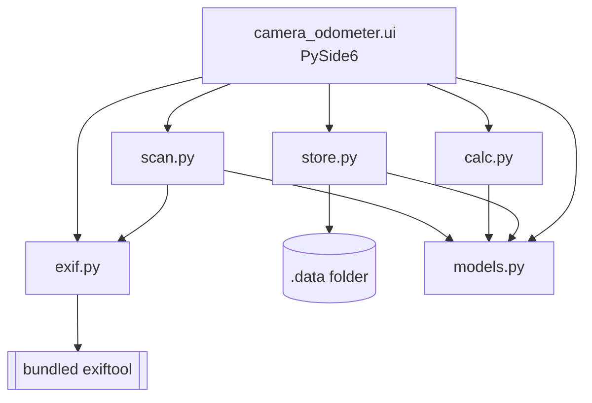

# Architecture



- **Engine** (`exif`, `scan`, `calc`, `store`) uses only the standard library and never imports Qt. It runs and is tested on Linux and Windows.
- **UI** (`camera_odometer/ui/`) is PySide6. It calls the engine from worker threads and never parses metadata itself.
- **`models.py`** is the contract between the two. Change it deliberately.

## Engine API

### `exif.py`

```python
def find_exiftool() -> list[str]            # argv prefix; bundled, then vendor/, then PATH

class ExifTool:                              # one long-lived `-stay_open` process, thread-safe
    def __init__(self, command: list[str] | None = None)
    def read(self, paths: list[str]) -> list[Shot]                      # same order as input
    def thumbnails(self, paths: list[str]) -> dict[str, tuple[bytes, int]]  # JPEG bytes, rotation in degrees clockwise
    def preview(self, path: str) -> tuple[bytes, int] | None            # large embedded JPEG, rotation
    def close(self) -> None                                              # also a context manager
```

### `scan.py`

```python
RAW_EXTS: frozenset[str]      # originals that can carry a shutter count
IMAGE_EXTS: frozenset[str]    # RAW_EXTS plus jpg / jpeg / heic

class ScanCancelled(Exception)

def list_images(folder: str) -> list[str]   # absolute paths, natural sort, for the gallery

def scan(root: str, year: int, et: ExifTool, *,
         cache: dict | None = None,
         progress: Callable[[int, int, str], None] | None = None,   # done, total, message
         cancelled: Callable[[], bool] | None = None) -> ScanResult
```

### `calc.py`

```python
def effective_label(rel: str, labels: dict[str, str]) -> str | None
def summarize(scan: ScanResult, labels: dict[str, str], excluded: Iterable[str] = ()) -> Summary
def to_csv(scan: ScanResult, summary: Summary) -> str
```

### `store.py`

```python
def app_dir() -> Path     # folder of the exe when frozen, repo root otherwise
def data_dir() -> Path    # app_dir() / ".data", created on demand, hidden attribute set on Windows

class Store:
    def __init__(self, directory: Path | None = None)
    def settings(self) -> dict
    def save_settings(self, settings: dict) -> None
    def load_session(self, root: str, year: int) -> Session | None
    def save_session(self, session: Session) -> None
    def sessions(self) -> list[Session]          # newest first
    def load_cache(self) -> dict
    def save_cache(self, cache: dict) -> None
```

## Smart scan

The scan reads metadata from a few files per folder instead of every photo.

1. **Walk** the tree once with `os.scandir`. No file is opened.
2. **Group** each folder's images by `(filename prefix, extension)`, for example `DSC` + `.arw` and `_DSC` + `.arw`. Different bodies almost always differ in prefix, so each group is one body's run. Sort each group in natural filename order.
3. **Probe both ends** of every group in one batched exiftool call.
4. Decide per group:
   - both ends inside the year: the group's range is `first..last`;
   - both ends on the same side outside the year: skip;
   - ends straddle a year boundary: **bisect** by capture date to find the first / last in-year file;
   - ends disagree (different body, dates or counters out of order, a bisect probe out of order): **read the whole group** and split it by body.
5. Merge groups into one `CameraRange` per `(folder, body)`, then one `Camera` per body across folders.

Files with no shutter count are derivatives (exports, merged DNGs) when the same camera model has counts elsewhere, and are ignored. A model with no counts anywhere becomes an **estimated** body: its actuations are its file count.

Probe results are cached in `.data` by path, size and modified time, so a rescan reads almost nothing.

Known ceiling: two bodies that share a filename prefix inside one folder are only detected when the group's two ends come from different bodies.

## Calculation

See [calculation.md](calculation.md).

## Data folder

`.data/` sits next to the executable and is hidden. It holds JSON only: `settings.json`, `cache.json`, and one session file per `(root, year)`.
