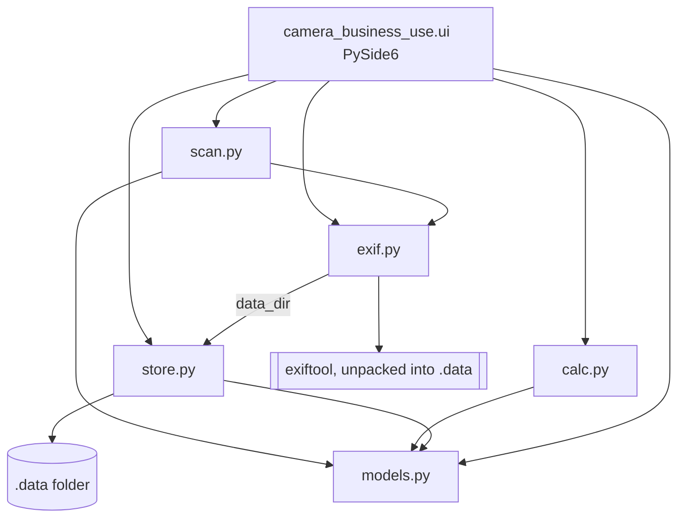

# Architecture



- **Engine** (`exif`, `scan`, `calc`, `store`) uses only the standard library and never imports Qt. It runs and is tested on Linux and Windows.
- **UI** (`camera_business_use/ui/`) is PySide6. It calls the engine from worker threads and never parses metadata itself.
- **`models.py`** is the contract between the two. Change it deliberately.
- **Nothing about a scan is saved.** The scan result, the labels and the excluded bodies (`models.Session`) live in the window's memory; the CSV export is the record. Only the last-used settings and the probe cache are written to disk.

## Engine API

### `exif.py`

```python
class ExifToolError(RuntimeError)            # not found, not unpacked, not started, or the process is gone

def find_exiftool() -> list[str]            # argv prefix; frozen bundle, then vendor/, then PATH

class ExifTool:                              # one long-lived `-stay_open` process, thread-safe
    def __init__(self, command: list[str] | None = None)
    def read(self, paths: list[str]) -> list[Shot]                      # same order as input
    def thumbnails(self, paths: list[str]) -> dict[str, tuple[bytes, int]]  # JPEG bytes, rotation in degrees clockwise
    def preview(self, path: str) -> tuple[bytes, int] | None            # large embedded JPEG, rotation
    def metadata(self, path: str) -> list[tuple[str, str, str]]          # every tag: (group, description, value)
    alive: bool                                                          # False once the process has exited
    def close(self, wait: float = 5) -> None                             # also a context manager
```

- **Frozen app**: the bundle carries `exiftool-<version>.zip`. `find_exiftool()` unpacks it once into `store.data_dir() / "exiftool-<version>"` (into a `.tmp` folder, then a rename) and removes other versions. This is the only engine-to-engine import besides `models`.
- **`close(wait)`** lets the process exit. If a call is still running after `wait` seconds it kills the process instead, and that call raises `ExifToolError` in its thread. The UI relies on this so that closing the window never hangs.
- **A dead process** makes every call raise `ExifToolError`. The owner checks `alive` and makes a new `ExifTool` (the UI's `Engine.et()` does).
- **`metadata(path)`** reads `-G1 -a -l` and keeps file order. ExifTool's own group is left out, lists are joined with ", ", and binary fields stay ExifTool's "(Binary data N bytes, …)" note (never `-b`). It backs the View Metadata dialog.
- A file ExifTool cannot read gives a blank `Shot`, and so does a path that cannot be sent as a UTF-8 line. `ImageCount` stands in for `ShutterCount`, so callers must only pass camera files (`IMAGE_EXTS`).

### `scan.py`

```python
RAW_EXTS: frozenset[str]      # originals that can carry a shutter count: ".arw", ".cr3", ...
IMAGE_EXTS: frozenset[str]    # RAW_EXTS plus ".jpg", ".jpeg", ".heic" (lower case, leading dot)

class ScanCancelled(Exception)

def list_images(folder: str) -> list[str]   # absolute paths, natural sort, for the gallery

def scan(roots: str | list[str], year: int, et: ExifTool, *,
         cache: dict | None = None,
         progress: Callable[[int, int, str], None] | None = None,   # done, total, message
         cancelled: Callable[[], bool] | None = None) -> ScanResult
```

- **Several photo folders** are scanned as one library: bodies, ranges, the derivative rule and warnings are worked out over all of them together.

  | Selection | `ScanResult.root` | `Folder.rel` |
  | --- | --- | --- |
  | One folder | that folder | relative to it; the folder itself is `""` |
  | Several with a common parent | the common parent | starts with each folder's path below the parent |
  | Folders on different drives | `""` | absolute path with `/` separators |

  A folder that lies inside another selected folder is dropped. `ScanResult.roots` lists the folders that were scanned.
- **Errors**: a selected folder that cannot be read raises `OSError`. An unreadable sub-folder becomes a line in `ScanResult.warnings` and the scan carries on.
- **Progress**: `done` and `total` count metadata reads, cached ones included. `total` is not known up front: it grows whenever a group needs a bisect or a full read, so `done / total` can drop. The UI shows the largest fraction reached.
- **Cancel**: `cancelled()` is polled between ExifTool calls; the scan then raises `ScanCancelled`.

### `calc.py`

```python
def effective_label(rel: str, labels: dict[str, str]) -> str | None
def summarize(scan: ScanResult, labels: dict[str, str], excluded: Iterable[str] = ()) -> Summary
def to_csv(scan: ScanResult, summary: Summary, excluded: Iterable[str] = ()) -> str   # same `excluded` as summarize
```

### `store.py`

```python
def app_dir() -> Path     # folder of the exe when frozen, repo root otherwise
def data_dir() -> Path    # app_dir() / ".data", created on demand, hidden attribute set on Windows

class Store:
    def __init__(self, directory: Path | None = None)
    def settings(self) -> dict
    def save_settings(self, settings: dict) -> None
    def load_cache(self) -> dict
    def save_cache(self, cache: dict) -> None
```

- Both files are conveniences and **never fail**: a missing or corrupt file reads as `{}`, and a write that cannot be done is skipped.
- Writes are atomic (temp file, then rename).

## Smart scan

The scan reads metadata from a few files per folder instead of every photo.

1. **Walk** every selected folder once with `os.scandir`. No file is opened.
2. **Group** each folder's images by `(filename prefix, extension)`, for example `DSC` + `.arw` and `_DSC` + `.arw`. Different bodies almost always differ in prefix, so each group is one body's run. Sort each group in natural filename order.
3. **Probe both ends** of every group in one batched exiftool call.
4. Decide per group:
   - both ends inside the year: the group's range is `first..last`;
   - both ends on the same side outside the year: skip;
   - ends straddle a year boundary: **bisect** by capture date to find the first / last in-year file;
   - ends in reverse order (the newer file sorts first): the file numbers **rolled over** (`9999` to `0001`). Bisect for the seam and rotate the group back into shooting order, then decide as above;
   - ends disagree (different body, or a probe that fits neither order): **read the whole group** and split it by body.
5. Merge groups into one `CameraRange` per `(folder, body)`. A **sparse** one (span ≥ frames + 100 and ≥ 3 × frames, see [calculation.md](calculation.md#sparse-folders)) is read in full and split into one `CameraRange` per day of shooting, so `Folder.ranges` can hold several entries for one body.
6. One `Camera` per body across folders: the hull of its ranges.

Files with no shutter count are derivatives (exports, merged DNGs) when the same camera model has counts elsewhere, and are ignored. A model with no counts anywhere becomes an **estimated** body: its actuations are its file count.

- **Count-less ends.** A group whose two ends have no count is taken for derivatives after one more probe in the middle; a count there triggers the full read instead.
- **Identical ends.** If both ends are the same frame (same second, same count) in a group of more than two files, their order says nothing, so the group is read in full.
- **Frames** of a folder and body are its distinct file names without extension, so a raw + JPEG pair is one frame.
- **Cache.** Probe results are cached in `.data` by path, size and modified time, so a rescan reads almost nothing. Failed reads are never cached, and a damaged entry is a miss.

### Known ceilings

- Two bodies that share a filename prefix inside one folder are only detected when the group's two ends come from different bodies.
- Originals hidden in a group whose two ends **and** middle file have no count are skipped as derivatives.

## Calculation

See [calculation.md](calculation.md).

## Data folder

`.data/` sits next to the executable (the repo root when run from source) and is hidden.

| Entry | Contents |
| --- | --- |
| `settings.json` | Photo folders and tax year used last |
| `cache.json` | Probe results by path, size and modified time |
| `exiftool-<version>/` | Frozen app only: ExifTool, unpacked from the bundle on first use |
