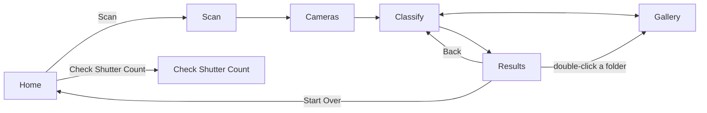

# UI / UX Design

Target user: a photographer at tax time. Not a developer. Every screen answers one question and has one primary action.

## Flow



- A persistent **step bar** at the top shows `1 Folder · 2 Cameras · 3 Classify · 4 Results`. Every step up to the furthest one reached since the scan is clickable, so going back to Cameras does not lock Results.
- On the right of the step bar, after a scan, **Included Folders ▾** drops down the scanned photo folders, each with its number of photos from the year. Nothing else. Short messages (a saved CSV, an error) appear to its left.
- `Esc` always goes back one level. `Enter` moves forward: Scan, Continue, See Results.
- **Hotkeys are drawn as key caps** in a legend (`[Space] Gallery`), with the action in Title Case, never as a sentence. Cameras, Classify and the Gallery each have one. Buttons carry no key hints of their own.
- Button and action names are in Title Case with no ellipsis: **Add Folder**, **Check Shutter Count**, **See Results**, **Start Over**. Only "← Back to folders" keeps its sentence case.
- **Nothing is saved between launches** except the photo folders and year used last. Labels live as long as the window; the CSV export is the record. This keeps the app free of stale or half-written state.
- **Closing** with labels that have not been exported (or copied) asks once: "Labels are not saved. Close anyway?"

## Screens

### 1. Home

- **Photo folders**: a short list, one row per folder with a **Remove** button, for libraries split over several folders or drives. **Add Folder** opens the folder picker; a path typed or pasted into the field is added with `Enter`. The list is remembered.
  - The list grows to four and a half rows, then scrolls (the half row shows there is more). A new folder scrolls into view. The page keeps a margin above and below, so nothing is squeezed at 1100 × 700.
- **Tax year**: a plain number field; type it, or step it with the arrow keys or the wheel (the stock spin arrows cannot be themed without image files, so they are hidden). Defaults to last calendar year.
- **Scan** (primary button, `Enter` when the path field is empty). A scan in the same window keeps the labels of folders that are still there.
- **Check Shutter Count** (secondary button): opens the single-image tool.

### 2. Scan

- Progress bar, current folder name, counts ("412 of 618 files read"). **Cancel** `[Esc]` returns to Home.
- Lists up to four photo folders; with more it shows three and "and N more".
- The number of files to read is only known as the scan goes, so the count can grow. The bar never moves backwards.
- No decisions here. On finish, goes straight to Cameras.

### 3. Cameras

Title: "We found 3 cameras used in 2025". One card per camera body found in the year, up to four in a row when the window is wide enough:

| Field | Example |
| --- | --- |
| Name | Sony ILCE-7CM2 |
| Serial | 04417358 |
| First shot | Jan 18 · #14,210 |
| Last shot | Oct 31 · #24,105 |
| Year actuations | 9,896 |

- A check box at the card's top right, with no text (tooltip "Include in calculation", default on). Untick it to drop a friend's camera or a drone; the card dims.
- Bodies with no shutter count show an **Estimated from file count** badge at the foot of the card (beside the name it would stop four cards fitting a row).
- Footer: total actuations across included bodies on the left, the key legend (`[Enter] Continue  [Esc] Back`) centred, **Back** and **Continue** on the right.

### 4. Classify

```
┌ 1 Folder ─ 2 Cameras ─ [3 Classify] ─ 4 Results ─────────── Included Folders ▾ ┐
│ ▾ Library                          │  Studio                                    │
│     ● 02-08 Sample Shoot      BUS  │  06-21 Sample Wedding                      │
│     ● 03-14 Sample Meet       PER  │  Jun 20 – Jun 21, 2025  [Personal][Business]│
│   ▶ ○ 06-21 Sample Wedding         │  ───────────────────────────────────────── │
│     ○ 09-12 Sample Hike            │  Sony ILCE-7CM2     #18,300 → #19,711  1,412│
│   ▾ ● 04-26 Sample Race       BUS  │  [thumb] [thumb] [thumb] [thumb]           │
│       ● Course           (inherit) │  [thumb] [thumb] [thumb] [thumb]           │
├────────────────────────────────────┴────────────────────────────────────────────┤
│ 14 / 38            [←] Personal  [→] Business  [↑][↓] Move  [Space] Gallery …  │
│ FOLDERS CLASSIFIED                                              [See Results]  │
└─────────────────────────────────────────────────────────────────────────────────┘
```

- **Left**: folder tree, fully expanded, only folders that hold in-year shots (plus their ancestors). Each row shows a status dot and a label chip. The chevron expands and collapses a row.
- **Top row**: the library itself. With one photo folder it is that folder; with several it is their common parent and each photo folder is a row below it. These rows can be classified like any other, which labels everything inside in one keystroke.
- **Right**: the selected folder fills the space, with no card around it: date range, per-body shutter range and count, and evenly spaced previews.
  - **Personal** / **Business** buttons sit on the date row. The folder's own label lights its button; an inherited one tints it and shows "Inherited".
  - **Previews** fill the space left: the grid with cells from 120 to 240 px wide that covers the most of it, so a short or wide window gets more rows rather than one row and empty space. A row that only groups other folders shows no previews.
- **Bottom bar**: classified count on the left ("14 / 38", in the Cameras footer style), the key legend in the middle, **See Results** on the right.

| Key | Action |
| --- | --- |
| `↑` / `↓` | Previous / next folder |
| `←` | Mark **Personal**, jump to next unclassified |
| `→` | Mark **Business**, jump to next unclassified |
| `Backspace` | Clear label |
| `Space` | Open gallery for this folder |
| `Enter` | Go to Results |
| `Esc` | Back to Cameras |

- **Inheritance**: a label on a folder applies to every sub-folder that has no label of its own. Inherited labels are drawn dimmed with "(inherit)".
- **Feedback**: the folder's area flashes the label colour (border and tint) and slides toward that side for about 150 ms before the selection advances.
- **Colours**: Personal is blue, Business is amber. Unclassified is neutral grey. Colour is never the only signal: chips and buttons carry text.

### 5. Gallery

- Opens over the Classify page for one folder. Thumbnail grid of the folder's original images, loaded lazily.
- Arrow keys move the selection. `Enter` opens the single-image view; `←` / `→` flip between images there. `Esc` steps back out (image → grid → Classify).
- **Single image, mouse**: a click on the left or right third of the view flips back or forward; the middle third does nothing. Hovering a side that can flip shows a soft bar from that edge with a chevron and a pointing hand. The first and last image show no bar on the side with nothing to flip to.
- The header carries a key legend for whichever view is showing (grid: Move, Open, Personal, Business, Back; image: Flip, Personal, Business, Grid).
- `P` / `B` classify the folder from inside the gallery and return to Classify.
- Images come from the JPEG preview embedded in each raw file, so nothing is decoded from raw data.

### 6. Results

- Hero number: **Business use 74.2%**.
- Stacked bar: Business · Personal · Unclassified · Unattributed.
- Table per folder: label, raw range, credited actuations. Sortable. **Double-click** a row to go back to Classify on that folder with its photos open; `Esc` then lands on the folder.
- **Warnings** panel: overlapping albums, estimated bodies, albums whose counter moved less than their file count.
- **Export CSV** (primary button, for tax records) and **Copy Summary**. A line under them says that labels are not saved when the app closes.
- Footer: **← Back to folders** `[Esc]` on the left; on the right the "N folders still unclassified" note and **Start Over**, which drops the session and returns to Home (asking first, like closing, when labels were not exported).

### Check Shutter Count

- Dialog: drop an image or **Browse**. Shows shutter count (large), camera, serial, capture date.
- **View Metadata** (next to Browse, enabled once a photo file is chosen) opens every tag ExifTool reads from the file: a Group · Tag · Value table in file order, with a filter and a tag count. Files differ a lot (a raw holds hundreds of tags, an edited export a handful), so nothing is assumed: long values are cut to one line with the full text in a tooltip, binary fields show as "(Binary data N bytes)", and a file with nothing readable gets a plain message.
- States plainly when a file has no shutter count (edited export, unsupported body).
- Accepts only photo files (the extensions the scan reads); anything else gets a plain message instead of a made-up count.

## Visual direction

- Dark, neutral, darkroom-like. Content first, thin separators, generous spacing.
- One accent per meaning: blue = personal, amber = business, red only for warnings.
- System font (Segoe UI Variable), large numerals for counts.
- Minimum window 1100 × 700; layouts stretch, no fixed pixel positions.
