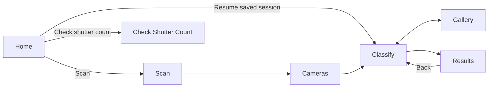

# UI / UX Design

Target user: a photographer at tax time. Not a developer. Every screen answers one question and has one primary action.

## Flow



- A persistent **step bar** at the top shows `1 Folder · 2 Cameras · 3 Classify · 4 Results`. Completed steps are clickable.
- `Esc` always goes back one level. Progress is saved automatically after every change; there is no Save button.

## Screens

### 1. Home

- **Photo folder**: path field + Browse button. Remembers the last folder.
- **Tax year**: spin box, defaults to last calendar year.
- **Scan** (primary button, `Enter`).
- **Recent sessions** list: folder, year, saved date, "74% business" if finished. Click to resume without rescanning.
- **Check shutter count** (secondary button): opens the single-image tool.

### 2. Scan

- Progress bar, current folder name, counts ("412 of 618 files read"). **Cancel** returns to Home.
- No decisions here. On finish, goes straight to Cameras.

### 3. Cameras

One card per camera body found in the year:

| Field | Example |
| --- | --- |
| Name | Sony ILCE-7CM2 |
| Serial | 04417358 |
| First shot | Jan 18 · #14,210 |
| Last shot | Oct 31 · #24,105 |
| Year actuations | 9,896 |

- Checkbox **Include in calculation** (default on). Use it to drop a friend's camera or a drone.
- Bodies with no shutter count show an **Estimated from file count** badge.
- Footer: total actuations across included bodies. **Continue** (`Enter`).

### 4. Classify

```
┌ 1 Folder ─ 2 Cameras ─ [3 Classify] ─ 4 Results ──────── 14 / 38 classified ┐
│ ▾ Library                          │  06-21 Sample Wedding                   │
│     ● 02-08 Sample Shoot      BUS  │  Jun 20 – Jun 21, 2025                  │
│     ● 03-14 Sample Meet       PER  │                                         │
│   ▶ ○ 06-21 Sample Wedding         │  Sony ILCE-7CM2     #18,300 → #19,711   │
│     ○ 09-12 Sample Hike            │                         1,412 shots     │
│   ▾ ● 04-26 Sample Race       BUS  │  Sony ILCE-7M4      #11,110 → #11,887   │
│       ● Course           (inherit) │                           778 shots     │
│                                    │  [thumb] [thumb] [thumb] [thumb] [thumb]│
│                                    │                                         │
│  ◄ PERSONAL          ▲▼ move · Enter gallery · Backspace clear   BUSINESS ► │
└──────────────────────────────────────────────────────────────────────────────┘
```

- **Left**: folder tree, fully expanded, only folders that hold in-year shots (plus their ancestors). Each row shows a status dot and a label chip.
- **Right**: card for the selected folder: date range, per-body shutter range and count, and a strip of up to 8 evenly spaced thumbnails.
- **Bottom bar**: two large targets, Personal on the left and Business on the right, so mouse users get the same model as the keyboard.

| Key | Action |
| --- | --- |
| `↑` / `↓` | Previous / next folder |
| `←` | Mark **Personal**, jump to next unclassified |
| `→` | Mark **Business**, jump to next unclassified |
| `Backspace` | Clear label |
| `Enter` | Open gallery for this folder |
| `Space` | Expand / collapse |
| `Ctrl+Enter` | Go to Results |
| `Esc` | Back to Cameras |

- **Inheritance**: a label on a folder applies to every sub-folder that has no label of its own. Inherited labels are drawn dimmed with "(inherit)".
- **Feedback**: the card flashes the label colour and slides toward that side for about 150 ms before the selection advances.
- **Colours**: Personal is blue, Business is amber. Unclassified is neutral grey. Colour is never the only signal: chips carry text.
- When nothing is left unclassified, a banner offers **See results** (`Ctrl+Enter`).

### 5. Gallery

- Opens over the Classify page for one folder. Thumbnail grid of the folder's original images, loaded lazily.
- Arrow keys move the selection. `Enter` opens the single-image view; `←` / `→` flip between images there. `Esc` steps back out (image → grid → Classify).
- `P` / `B` classify the folder from inside the gallery and return to Classify.
- Images come from the JPEG preview embedded in each raw file, so nothing is decoded from raw data.

### 6. Results

- Hero number: **Business use 74.2%**.
- Stacked bar: Business · Personal · Unclassified · Unattributed.
- Table per folder: label, raw range, credited actuations. Sortable.
- **Warnings** panel: overlapping albums, estimated bodies, albums whose counter moved less than their file count.
- **Export CSV** (for tax records) and **Copy summary**.

### Check Shutter Count

- Dialog: drop an image or Browse. Shows shutter count (large), camera, serial, capture date.
- States plainly when a file has no shutter count (edited export, unsupported body).

## Visual direction

- Dark, neutral, darkroom-like. Content first, thin separators, generous spacing.
- One accent per meaning: blue = personal, amber = business, red only for warnings.
- System font (Segoe UI Variable), large numerals for counts.
- Minimum window 1100 × 700; layouts stretch, no fixed pixel positions.
