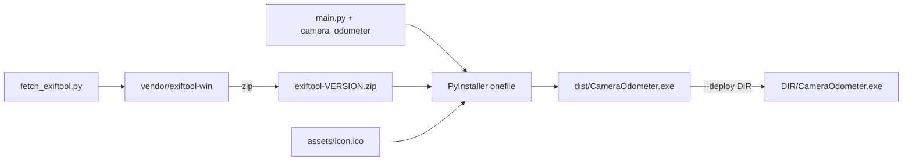

# Development

Developed in WSL, built and run with a Windows Python. The engine needs only the standard library; the UI needs PySide6.

## Prerequisites

- **WSL** (Ubuntu) with `python3` 3.12 and `perl`, for the engine, its tests and the scan CLI.
- **Windows Python 3.12**, reachable from WSL as `python.exe`, for the UI and the build.
- Internet access once, to download ExifTool.

## Setup

```bash
python.exe -m venv .venv-win
chmod +x .venv-win/Scripts/*.exe
.venv-win/Scripts/python.exe -m pip install -r requirements.txt
python3 scripts/fetch_exiftool.py
```

- **`chmod +x`**: WSL refuses to run a Windows `.exe` inside the Linux filesystem without the exec bit. Repeat it after installing a package that adds executables.
- **UNC working directory**: a Windows process started from the repo runs in `\\wsl.localhost\Ubuntu\...`. Python and PyInstaller are fine with that. `cmd.exe` is not, so there are no `.bat` files here.
- **Environment variables** set in WSL do not reach Windows processes unless they are named in `WSLENV`.

## ExifTool

`scripts/fetch_exiftool.py` downloads the pinned version, checks its SHA-256 and unpacks it into `vendor/` (git-ignored):

| Folder | Contents | Used by |
| --- | --- | --- |
| `vendor/exiftool-win/` | `exiftool.exe` + `exiftool_files/` | Windows runs from source, and the build |
| `vendor/exiftool-perl/` | Perl distribution | Linux: `perl vendor/exiftool-perl/exiftool` |

- It does nothing for a package that is already there at the pinned version.
- **To upgrade**: change `VERSION` and both hashes at the top of the script, then run it again.

## Run from source

```bash
.venv-win/Scripts/python.exe main.py            # the app, in a real window on the Windows desktop
.venv-win/Scripts/python.exe main.py --demo     # same, with an invented photo library
```

Two flags run without opening a window (Qt's `offscreen` platform) and exit by themselves:

```bash
.venv-win/Scripts/python.exe main.py --selftest                   # keyboard-handling checks; exit code 0 = pass
.venv-win/Scripts/python.exe main.py --screenshots build/screens  # one PNG per screen, from the demo library
```

- Both use the demo library and a scratch data folder, `build/demo-data/`. They never start ExifTool and never touch `.data/`.
- The `offscreen` platform starts with no fonts. Code that draws text there must load one first (`QFontDatabase.addApplicationFont`), or every glyph is an empty box.

## Engine tests and scan CLI

```bash
python3 -m unittest discover -s tests
python3 -m camera_odometer.scan "/mnt/d/Photos" 2025
```

- The tests need neither Qt nor ExifTool.
- Which checks to run for which kind of change: `.claude/skills/validate/SKILL.md`.
- The scan CLI prints the cameras and folders it finds for that year. It reads and writes the probe cache in `.data/` at the repo root.

## Build the exe

```bash
.venv-win/Scripts/python.exe scripts/build.py --deploy 'D:\Apps\CameraOdometer'
```



- Takes about a minute. Output: `dist/CameraOdometer.exe`, about 38 MB.
- **`--deploy DIR`** also copies the exe to a folder on a Windows drive. Run it from there: from the `\\wsl.localhost` path a start takes over 30 s.
- **`--entry FILE`** freezes another script instead of `main.py` (used for startup experiments).
- The PyInstaller spec is generated into `build/pyinstaller/` on every build. Change `scripts/build.py`, not the spec.
- The icon is drawn by `scripts/make_icon.py` (run it with the Windows venv Python). It also writes `build/icon-preview.png`; look at that before committing a new `assets/icon.ico`.

### What the build does for startup time

A onefile exe unpacks its whole payload to `%TEMP%` on every launch, and Windows scans each file as it lands. Launch to first window, warm runs, an offscreen hello window:

| Bundle | Seconds |
| --- | --- |
| ExifTool as 510 loose files | 4.2 |
| ExifTool as one zip | 2.7 |
| One zip, unused Qt files dropped (**current**) | 2.1 |

- **ExifTool is one zip** at the bundle root, `exiftool-<version>.zip`. The app unpacks it once (about 2 s) next to the exe and reuses it after that.
- **Dropped Qt files** (`DROP` in `scripts/build.py`): the software OpenGL fallback, Qt's own translations, and QtNetwork. Code that starts using `PySide6.QtNetwork` must take it off that list and out of the spec's `excludes`.

## The `.data` folder

- From source: `<repo>/.data/` (git-ignored). Frozen: next to `CameraOdometer.exe`. Hidden on Windows.
- Holds `settings.json`, `cache.json` and the session files, and in the frozen app `exiftool-<version>/`.
- Safe to delete. Sessions and settings are lost; ExifTool is unpacked again on the next start.

## Troubleshooting

| Symptom | Cause and fix |
| --- | --- |
| `Permission denied` running `.venv-win/Scripts/python.exe` | Exec bit missing: `chmod +x .venv-win/Scripts/*.exe`. |
| `WinError 4551`, "An Application Control policy has blocked this file", or `Invalid argument` when starting the exe from WSL | Windows **Smart App Control** rejected the unsigned exe. It judges each file on its own; two of nine test builds were blocked. A rebuild gives a new file and a new verdict. The lasting fixes are signing the exe or turning Smart App Control off, and neither is set up here. |
| The first start of a new exe takes 10 to 20 s | Windows scans a file it has not seen before. Later starts take about 2 s, with an occasional 5 s one. |
| Every start takes over 30 s | The exe is running from `\\wsl.localhost`. Copy it to a Windows drive (`--deploy`). |
| Text is drawn as empty boxes in a screenshot or the icon | The `offscreen` platform has no fonts; load one explicitly. |
