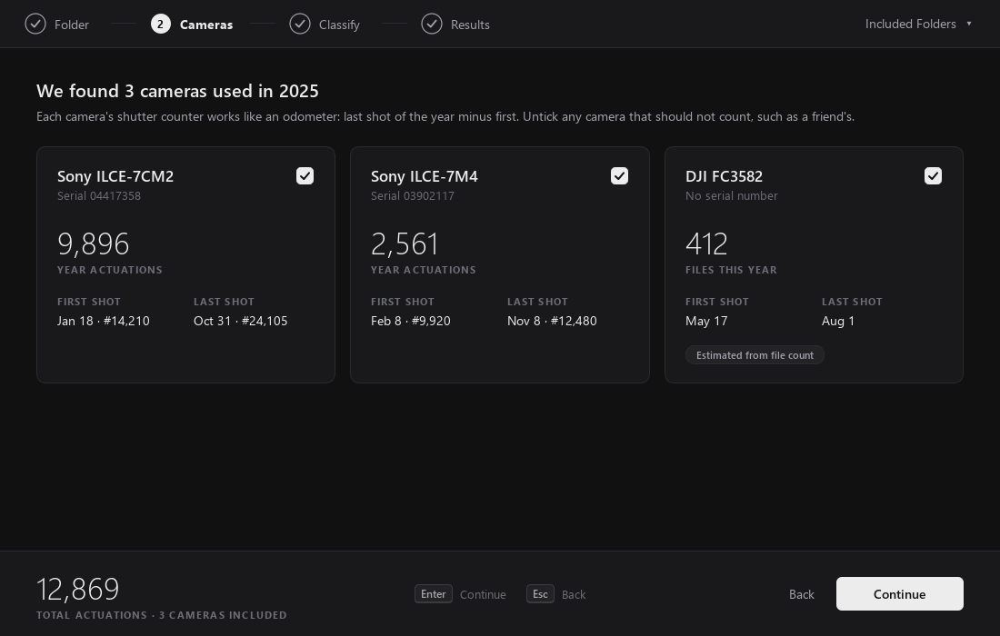
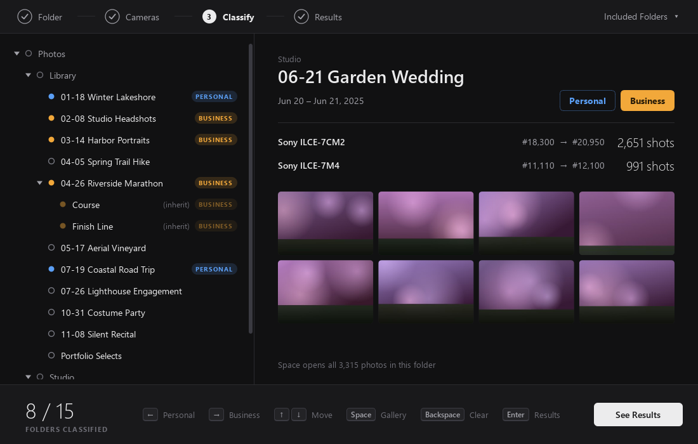
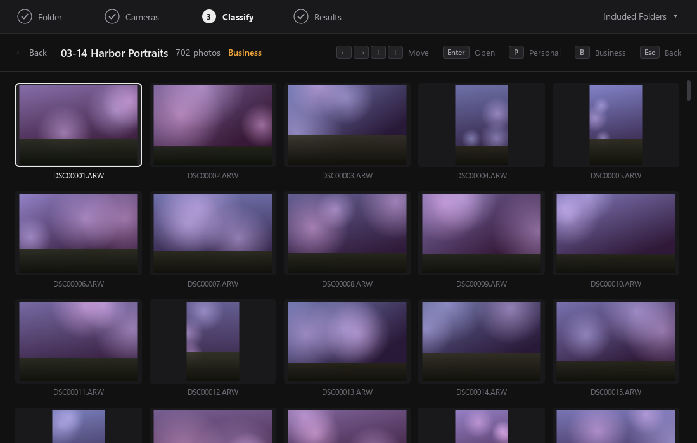
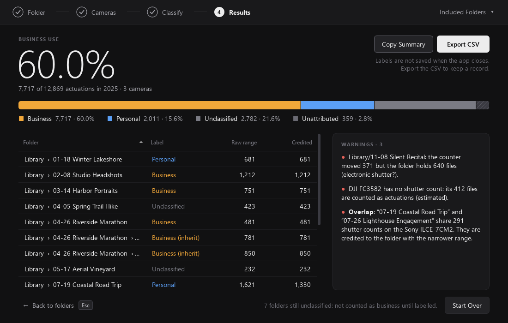

# User guide

Camera Odometer works out what share of your camera use in a tax year was for business. It reads the shutter count your camera writes into every photo, the way you would read a car's odometer in January and again in December.

## Get started

- Put `CameraOdometer.exe` in a folder of its own that you can write to (not `Program Files`). No installation.
- **The first launch takes 10 to 20 seconds** because Windows scans the new program. Later launches take about 2 seconds.
- The app only reads your photos. It never changes, moves or deletes them.

## 1. Choose your photo folders and the year

- **Add folder…** picks a folder that holds your photo folders. Add more if your library is split, for example a working folder and an archive drive. You can also paste a path and press `Enter`.
- **Remove** takes a folder off the list. Nothing is deleted from disk.
- Set the **tax year** and press **Scan** (`Enter`).
- The scan reads a few files per folder, not every photo, so it takes seconds to a few minutes. A second scan of the same folders is much faster.
- **Recent sessions** reopens earlier work without scanning again.

## 2. Check the cameras

- One card per camera body that took photos in that year, with its first and last shot and the shutter counts between them.
- **Untick** a camera that should not count, such as a friend's camera or one you only use privately.
- **Continue** (`Enter`).

## 3. Mark each folder Personal or Business

- Walk down the list with `↓`. Press `←` for **Personal** or `→` for **Business**. The selection jumps to the next folder that still needs an answer.
- A label on a folder also covers every folder inside it that has no label of its own (shown as *inherit*). Labelling a top row labels a whole photo folder at once.
- Not sure what a folder holds? Press `Enter` to look through its photos, then `P` or `B` right there.
- You can stop at any time. **Every change is saved as you make it.**

## 4. Read the result

- **Business use** is the percentage to take to your tax records.
- The bar and the table show where every shutter actuation of the year went.
- **Warnings** lists what deserves a second look.
- **Export CSV** saves the full breakdown; **Copy summary** puts a short text version on the clipboard.

## Check one photo's shutter count

On the first screen, **Check shutter count…** shows how many shots a camera had taken when it made one image. Drop a raw file or a JPEG straight from the camera onto the dialog, or choose **Browse…**. Useful when buying or selling a used camera.

## Keyboard

| Where | Key | Action |
| --- | --- | --- |
| Everywhere | `Esc` | Back one level |
| Home | `Enter` | Add the typed folder; with an empty field, scan |
| Cameras | `Enter` | Continue |
| Classify | `↑` / `↓` | Previous / next folder |
| | `←` | Personal, then jump to the next unclassified folder |
| | `→` | Business, then jump to the next unclassified folder |
| | `Backspace` | Clear the label |
| | `Space` | Expand / collapse |
| | `Enter` | Open the folder's photos |
| | `Ctrl+Enter` | Results |
| Gallery | Arrows | Move the selection |
| | `Enter` | Open the image; `←` / `→` flip through images |
| | `P` / `B` | Mark the folder Personal / Business and return |

## What the words mean

| Word | Meaning |
| --- | --- |
| **Actuation** | One click of the shutter counter. |
| **Unclassified** | Shots in folders you have not labelled yet. They do not count as business until you label them. |
| **Unattributed** | Shots the counter recorded during the year that are in none of your folders: photos you deleted, or albums kept somewhere you did not add. They count as **not business**. |
| **Estimated** | A camera that does not record a shutter count (many phones and drones). Each of its files counts as one actuation. |
| **Overlap** | Two folders hold shots from the same stretch of one camera's counter, for example a personal detour during a long job. Those shots go to the folder with the narrower range. |

The exact rules are in [calculation.md](calculation.md).

## Where your data is kept

- In a hidden folder named **`.data`** next to `CameraOdometer.exe`: your sessions, the folder list, a scan cache, and the app's copy of ExifTool.
- Nothing is sent anywhere and nothing is written into your photo folders.
- **To reset the app**, close it and delete `.data` (turn on *Hidden items* in File Explorer to see it). It is recreated on the next start.
- To move the app, move the exe and `.data` together.

## Accuracy notes

- **Per camera body.** Each body has its own odometer. A body is told apart by model and serial number.
- **Deleted photos** between two albums show up as *Unattributed* and count as non-business. That is the cautious reading; a large unattributed share usually means a photo folder is missing from the list.
- **Electronic shutter.** Some bodies do not advance the counter for silent-shutter frames. A warning names the folders where the counter moved less than the number of files.
- **Two bodies, one file-name prefix, one folder.** The scan notices this only when the first and the last file of the group come from different bodies. Otherwise the folder is credited to one body.
- **Smart App Control.** The exe is not code-signed, so Windows may refuse to start it. Nothing is wrong with the file; see [development.md](development.md#troubleshooting).
