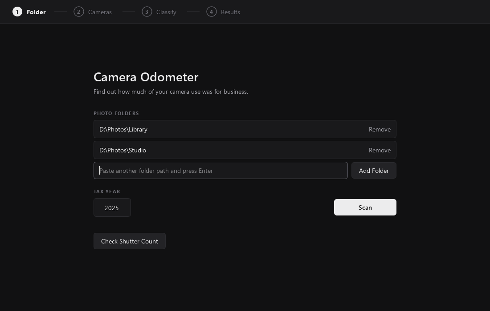

# User guide

Camera Odometer works out what share of your camera use in a tax year was for business. It reads the shutter count your camera writes into every photo, the way you would read a car's odometer in January and again in December.

## Get started

- Download `CameraOdometer.exe` from the project's [latest release](https://github.com/PoyoPoak/camera-odometer-calculator/releases/latest).
- Put it in a folder of its own that you can write to (not `Program Files`). No installation.
- **The first launch takes 10 to 20 seconds** because Windows scans the new program. Later launches take about 2 seconds.
- The app only reads your photos. It never changes, moves or deletes them.

## 1. Choose your photo folders and the year

- **Add Folder** picks a folder that holds your photo folders. Add more if your library is split, for example a working folder and an archive drive. You can also paste a path and press `Enter`.
- **Remove** takes a folder off the list. Nothing is deleted from disk.
- Type the **tax year** (or step it with the arrow keys) and press **Scan** (`Enter`).
- The scan reads a few files per folder, not every photo. Expect about a minute for a library of 25,000 files the first time and a few seconds after that.

## 2. Check the cameras

- One card per camera body that took photos in that year, with its first and last shot and the shutter counts between them.
- **Untick** the box at a card's top right for a camera that should not count, such as a friend's camera or one you only use privately.
- **Continue** (`Enter`). The keys for each screen are listed at the bottom (or top, in the photo view).

## 3. Mark each folder Personal or Business

- Walk down the list with `↓`. Press `←` for **Personal** or `→` for **Business**, or click the **Personal** / **Business** button next to the folder's dates. The selection jumps to the next folder that still needs an answer.
- A label on a folder also covers every folder inside it that has no label of its own (shown as *inherit*). Labelling a top row labels a whole photo folder at once.
- Not sure what a folder holds? Press `Space` to look through its photos, then `P` or `B` right there.
- The count at the bottom left shows how many folders have a label. Press `Enter` or **See Results** when you are done.
- **Included Folders** at the top right lists the photo folders of this scan and how many photos from the year each holds.
- **Labels are not saved when you close the app.** Finish in one sitting and export the result (next step). The app asks before closing if you have not.

## 4. Read the result

- **Business use** is the percentage to take to your tax records.
- The bar and the table show where every shutter actuation of the year went.
- **Warnings** lists what deserves a second look.
- **Export CSV** saves the full breakdown, folder by folder with its label. **This file is your record**: keep it with your tax papers.
- **Copy Summary** puts a short text version on the clipboard.
- **Double-click** a folder in the table to go back and look at its photos or change its label.
- **Start Over** returns to the first screen for a new scan. It asks first if you have not exported the CSV.

## Check one photo's shutter count

On the first screen, **Check Shutter Count** shows how many shots a camera had taken when it made one image. Drop a raw file or a JPEG straight from the camera onto the dialog, or choose **Browse**. Useful when buying or selling a used camera.

**View Metadata** lists everything stored in that file: camera settings, dates, lens, copyright and more. Type in the filter to find a tag. Different cameras and files hold very different tags, and an edited export may hold only a few.

## Keyboard

| Where | Key | Action |
| --- | --- | --- |
| Everywhere | `Esc` | Back one level |
| Home | `Enter` | Add the typed folder; with an empty field, scan |
| | `Tab`, then `Enter` | Reach and press a folder's **Remove** button |
| Cameras | `Enter` | Continue |
| Classify | `↑` / `↓` | Previous / next folder |
| | `←` | Personal, then jump to the next unclassified folder |
| | `→` | Business, then jump to the next unclassified folder |
| | `Backspace` | Clear the label |
| | `Space` | Open the folder's photos |
| | `Enter` | Results |
| Gallery | Arrows | Move the selection |
| | `Enter` | Open the image; `←` / `→` (or a click on the left or right of the image) flip through images |
| | `P` / `B` | Mark the folder Personal / Business and return |

## What the words mean

| Word | Meaning |
| --- | --- |
| **Actuation** | One click of the shutter counter. |
| **Unclassified** | Shots in folders you have not labelled yet. They do not count as business until you label them. |
| **Unattributed** | Shots the counter recorded during the year that are in none of your folders: photos you deleted, or albums kept somewhere you did not add. They count as **not business**. |
| **Estimated** | A camera that does not record a shutter count (many phones and drones). Each of its files counts as one actuation. |
| **Overlap** | Two folders hold shots from the same stretch of one camera's counter, for example a personal detour during a long job. Those shots go to the folder with the narrower range. |

The exact rules are in [calculation.md](calculation.md).

## Where your data is kept

- The app keeps very little: the photo folders and year you used last, a scan cache that makes the next scan fast, and its own copy of ExifTool. They sit in a hidden folder named **`.data`** next to `CameraOdometer.exe`.
- **Your labels and results are not kept.** The exported CSV is the only record.
- Nothing is sent anywhere and nothing is written into your photo folders.
- **To reset the app**, close it and delete `.data` (turn on *Hidden items* in File Explorer to see it). It is recreated on the next start.

## Accuracy notes

- **Per camera body.** Each body has its own odometer. A body is told apart by model and serial number.
- **Deleted photos** between two albums show up as *Unattributed* and count as non-business. That is the cautious reading; a large unattributed share usually means a photo folder is missing from the list.
- **Folders of keepers.** A folder holding a few photos from many shoots is credited only the days it holds photos from, not every shot in between. Its card shows the summed shots and "N separate days". Keepers from two shoots on the same day still count as one run.
- **Electronic shutter.** Some bodies do not advance the counter for silent-shutter frames. A warning names the folders where the counter moved less than the number of files.
- **Two bodies, one file-name prefix, one folder.** The scan notices this only when the first and the last file of the group come from different bodies. Otherwise the folder is credited to one body.
- **Smart App Control.** The exe is not code-signed, so Windows may refuse to start it. Nothing is wrong with the file; see [development.md](development.md#troubleshooting).
